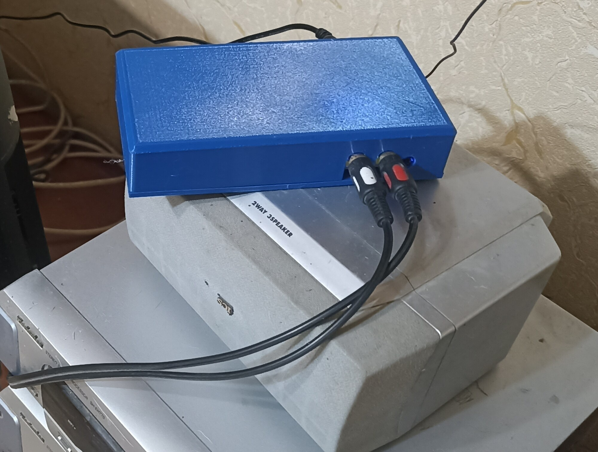
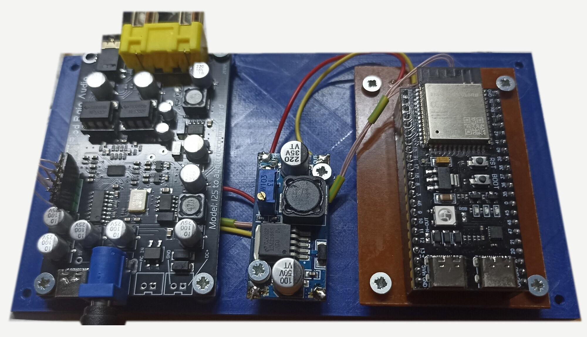
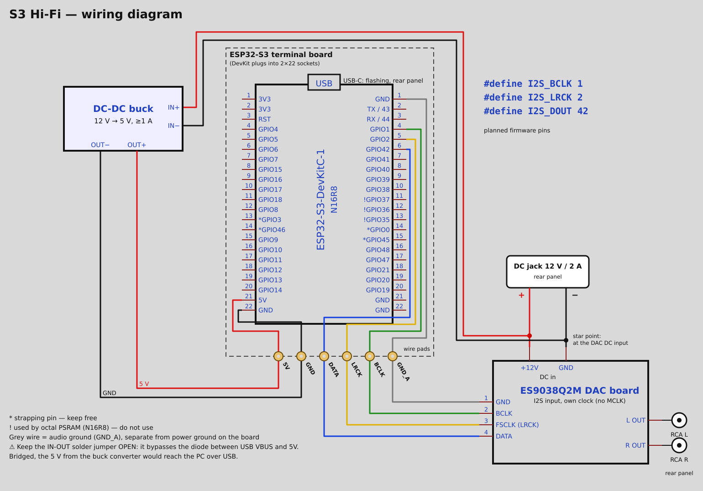
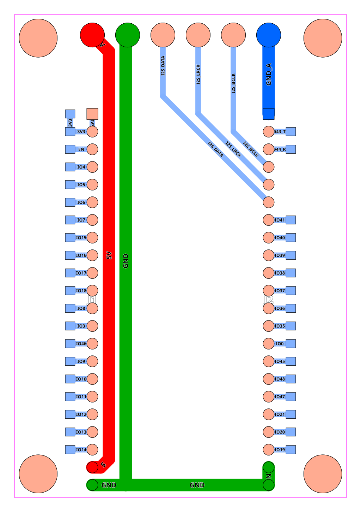

# S3 Hi-Fi

[English](README.md) · **Русский**

Сетевой Hi-Fi плеер для своей фонотеки (FLAC, WAV, MP3, DSD) и интернет-радио. Музыка лежит на домашнем сервере,
плеер на ESP32-S3 принимает готовый поток по Wi-Fi и отдаёт его в ЦАП ES9038Q2M.
Управление — с телефона, из браузера.

> **Статус:** каждый день играет дома. Готовы сервер 0.8 (с установщиком под Windows), прошивка плеера 0.8
> (плеер ещё и USB-ЦАП для компьютера), корпус и схема.
> Экрана нет нарочно: всё видно в телефоне, вместе с обложкой. Дальше — больше соединений, чтобы
> слушать через мобильный интернет (в машине).

  
  

Первая сборка: в корпусе на музыкальном центре и внутри.

## Главное в 0.7: плеер — ещё и USB-ЦАП для компьютера

Подключите плеер к компьютеру кабелем USB — и он станет для компьютера обычной звуковой картой
**«S3 Hi-Fi»**. Драйвер не нужен: Windows 10/11, Linux и macOS видят её сами (USB Audio Class 2).

> ⚠️ **У платы два разъёма USB-C, и они разные.** Прошивка — через разъём **COM** (UART).
> Звук с компьютера — через разъём **USB** (родной USB ESP32-S3). **После прошивки переткните кабель
> в другое гнездо — в USB**, иначе компьютер звуковую карту не увидит.

- **До 24 бит / 96 кГц:** 16 и 24 бит, 44,1 / 48 / 88,2 / 96 кГц. Выше USB Full Speed не пропускает.
- **Асинхронный режим:** темп задаёт генератор плеера, а компьютер подстраивается под него (обратная связь).
  Часы ПК и плеера не расходятся, щелчков нет.
- **Сеть и USB работают одновременно.** Компьютер начал играть (и в потоке есть звук) — сетевое
  воспроизведение встаёт на паузу, в настройках плеера видно «USB-ЦАП: играет компьютер». ▶ в пульте
  возвращает плеер сети. 5 секунд тишины, закрытый поток или выдернутый кабель — плеер отпускает USB;
  сеть сама не продолжает, нажмите ▶.
- **Громкость** — ползунок Windows. Для лучшего звука держите его на 100 %, а громкость крутите на усилителе.
- **Чтобы Windows не пересчитывала всё в 48 кГц**, выберите в своём плеере вывод **WASAPI (Exclusive)**
  на «S3 Hi-Fi» (в AIMP: Настройки → Воспроизведение → Устройство). Тогда частота переключается под
  каждый файл. Без этого Windows отдаёт звук в формате из «Свойства динамика → Дополнительно».
- Диагностика USB для любопытных: `http://<адрес плеера>/usb`.

## Быстрый старт

1. **Сервер** на Linux-компьютере, где лежит музыка:
   `curl -fsSL https://raw.githubusercontent.com/michkar-ekb/esp32-hifi-player/main/install.sh | sudo sh -s -- /путь/к/музыке`
   **Windows:** установщик `s3hifi-setup-<версия>.exe` из [Releases](https://github.com/michkar-ekb/esp32-hifi-player/releases/latest), подробнее — ниже, в разделе
   [Сервер на Windows](#сервер-на-windows).
2. **Плеер**: скачать из [Releases](https://github.com/michkar-ekb/esp32-hifi-player/releases/latest) архив `s3hifi-flash-windows.zip`, распаковать, подключить плату
   кабелем **в разъём COM** и запустить `flash.bat` — он спросит только номер COM-порта (Linux/Mac: `esptool`, см. [firmware](firmware)). Потом
   подключить телефон к Wi-Fi «S3 Hi-Fi Setup» и выбрать свою сеть. Сервер плеер найдёт сам.
   **Для звука с компьютера переткните кабель в другое гнездо — USB.** Прошивка кабелем нужна один раз:
   следующие версии, начиная с 0.7, обновляются по воздуху (см. [firmware](firmware/README.ru.md)).
3. **Пульт**: открыть на телефоне `http://<сервер>:8097`.

### Сервер на Windows

1. Скачайте `s3hifi-setup-<версия>.exe` из [Releases](https://github.com/michkar-ekb/esp32-hifi-player/releases/latest) и запустите.
2. **Windows может показать синее окно «Система Windows защитила ваш компьютер»** (или предупреждение
   антивируса). Так бывает с любой программой без платной цифровой подписи — это не вирус. Нажмите
   «Подробнее» → «Выполнить в любом случае». Весь исходный код открыт в этом репозитории, а контрольные
   суммы файлов лежат в `SHA256SUMS` рядом с релизом. То же окно может появиться и на `flash.bat`.
3. Установщик ставит сервер в «Program Files», добавляет его в автозагрузку и разрешает в брандмауэре
   для домашней сети. Если антивирус не даст добавить автозагрузку, установщик об этом скажет.
4. **При первом запуске сервер сам предложит выбрать папку с музыкой.** Подойдёт любая: на этом
   компьютере, сетевой диск (например `M:`) или `\\компьютер\папка` — путь можно вписать в строку окна.
   Папку на сетевом диске сервер запоминает как сетевой путь, поэтому после перезагрузки музыка находится,
   даже если буква диска ещё не подключилась.
5. Сервер живёт значком-пластинкой в трее (у часов). **Меню — по щелчку левой или правой кнопкой:**
   «Открыть пульт», «Музыка: …» (открыть папку), «Выбрать папку с музыкой…», «Журнал», «Выход».
6. Удаление — через «Параметры → Приложения». Настройки и выбранная папка остаются в `%USERPROFILE%\.s3hifi`.

Для DTS, APE, WavPack и ALAC положите `ffmpeg.exe` и `ffprobe.exe` в папку программы (подойдёт любая LGPL-сборка).

## Как это работает

- **Стриминг-сервер** (домашний ПК или мини-ПК, Windows или Linux) хранит музыку, раскодирует
  FLAC / WAV / MP3 / DSD и MP3-радио в PCM, ведёт очередь и список радиостанций, отдаёт веб-пульт.
- **ESP32-S3** ничего не декодирует: принимает PCM-поток по TCP, держит буфер ~10 секунд в PSRAM
  и ровно выдаёт его в I2S. Темп задаёт сам плеер, поэтому часы сервера и плеера не расходятся.
- **ЦАП ES9038Q2M** со своим генератором (MCLK не нужен) выдаёт линейный сигнал ~2 В
  на усилитель или активные колонки.

Потолок качества — 24 бит / 96 кГц: поток 4,6 Мбит/с, Wi-Fi спокойно тянет.

## Детали

| Узел | Что | Примечание |
|---|---|---|
| Плеер | ESP32-S3 DevKitC-1, **N16R8** | PSRAM обязательна — под буфер |
| ЦАП | плата ES9038Q2M (Rod Rain Audio) | вход I2S: GND, BCLK, FSCLK, DATA; выход RCA |
| Питание | блок 12 В / 2 А + DC-DC понижающий модуль 12 → 5 В | 12 В идёт на ЦАП, 5 В — на ESP32-S3 |
| Терминальная плата | терминальная плата ESP32-S3 (в этом репозитории) | гнёзда под девкит + 6 площадок под провода |

## Подключение

| ESP32-S3 | Площадка терминальной платы | ЦАП |
|---|---|---|
| 5V | 5V | — (от DC-DC модуля) |
| GND | GND | — (от DC-DC модуля) |
| GPIO42 | DATA | DATA |
| GPIO2 | LRCK | FSCLK |
| GPIO1 | BCLK | BCLK |
| GND | GND_A | GND |

Питание расходится **звездой прямо на входном разъёме ЦАПа**: одна пара проводов на ЦАП,
другая — на DC-DC модуль. Ток ESP32 не бежит по дорожкам ЦАПа.

## Терминальная плата ESP32-S3

Девкит вставляется в гнёзда, а все нужные плееру сигналы выведены на крупные площадки
под пайку проводов. Односторонняя, 48 × 69,65 мм, все дорожки снизу — под ЛУТ или маркер на 3D-принтере.

- `hardware/pcb/terminal_board_gerber.zip` — Gerber для заказа или травления
- `hardware/pcb/terminal_board_bottom_marker.stl` — нижний слой для печати маркером (зеркально, 0,2 мм)

## Программы

- [`server/`](server) — стриминг-сервер на Go со встроенным веб-пультом: папки, очередь, радио.
  Одна программа для **Windows и Linux**.
- [`firmware/`](firmware/README.ru.md) — прошивка плеера для ESP32-S3 (ядро Arduino 3.3.8): сетевой плеер и USB-ЦАП.

Плате ES9038Q2M нужны **32-битные отсчёты I2S**: с 16-битными слотами она выдаёт шум.
DSD сервер переводит в PCM 24 бит / 88,2 кГц: гребёнка I2S платы не умеет «родной» DSD.

## Корпус

Площадка и крышка для 3D-печати, `hardware/case/`: ЦАП, DC-DC модуль и терминальная плата на стойках;
спереди RCA и джек для наушников, сзади 12 В и оба USB-C. Рёбра скруглены на 3 мм, печать без поддержек.
Крышка держится на четырёх винтах M3 × 12 снизу. Это лишь мой вариант: подойдёт любой корпус
под ваши модули.

## Лицензия

Код — MIT. Схема и плата — CC BY-SA 4.0: повторяйте и переделывайте, указав автора.
